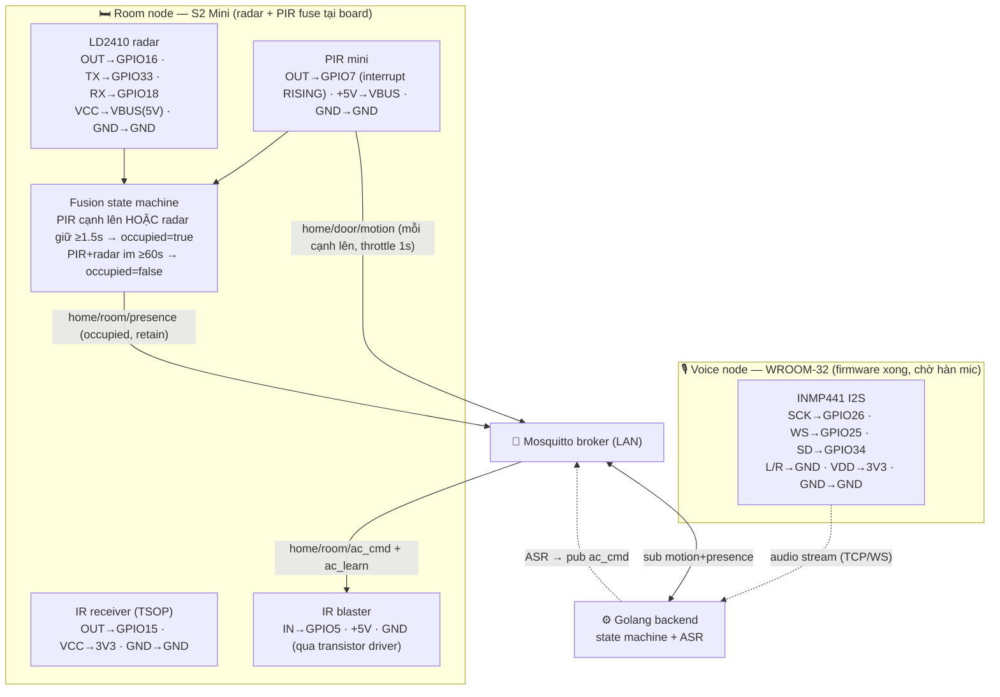

# Sơ đồ đấu nối IO — Hệ thống presence + AC + voice

Tài liệu đấu nối phần cứng cho toàn hệ thống. Xem sơ đồ bằng `/ck:preview` hoặc bất kỳ trình xem Markdown hỗ trợ Mermaid.

Cập nhật: 2026-07-15. Room-node gộp thêm PIR (fusion presence tại board); door-node cũ nghỉ hưu cho MVP 1 phòng (giữ file làm tham chiếu, không flash riêng nữa).

## Tổng quan 2 node (MVP 1 phòng)

| Node | Board | Peripheral | Vai trò | Trạng thái |
|------|-------|-----------|---------|------------|
| **Room** | Wemos S2 Mini (ESP32-S2) | LD2410 radar + PIR mini + IR receiver + IR blaster | Fuse PIR+radar tại board → `home/room/presence` (occupied); PIR cạnh lên → `home/door/motion`; nghe `ac_cmd`/`ac_learn` → điều khiển điều hòa | Firmware xong (fusion), chờ verify |
| **Voice** | ESP32-WROOM-32 (38 chân) | INMP441 I2S mic | Stream audio → backend ASR → `ac_cmd` | Firmware xong (VAD năng lượng + WS stream), chờ hàn mic + verify thực địa |

> **Door node cũ** (Wemos S2 Mini #1, chỉ có PIR) đã gộp logic vào Room node ở trên. `firmware/door-node/src/main.cpp` giữ lại làm tham chiếu (nguồn ISR PIR RISING), không còn flash/chạy độc lập cho MVP 1 phòng. Nếu sau này tách phòng thứ 2 mới cần board PIR riêng.

## Sơ đồ hệ thống

## Pin map chi tiết

### Room node — Wemos S2 Mini (radar + PIR + IR)

| Peripheral | Chân module | S2 Mini | Ghi chú |
|-----------|-------------|---------|---------|
| PIR mini | OUT (tín hiệu) | **GPIO7** | Có người → HIGH, đọc bằng interrupt RISING. Silk ghi "IN" nhưng với PIR đây là ngõ RA → vào GPIO7 (input ESP) |
| PIR mini | +5V | **VBUS (5V)** | Cấp 5V, KHÔNG phải 3V3 |
| PIR mini | GND | GND | |
| LD2410 radar | OUT (presence) | **GPIO16** | MVP đọc chân digital này |
| LD2410 radar | TX | **GPIO33** | UART để dành parse frame (MVP chưa dùng) |
| LD2410 radar | RX | **GPIO18** | UART để dành gửi config (MVP chưa dùng) |
| LD2410 radar | VCC | **VBUS (5V)** | |
| LD2410 radar | GND | GND | |
| IR receiver (TSOP) | OUT | **GPIO15** | Chỉ dùng lúc học mã IR |
| IR receiver | VCC / GND | 3V3 / GND | |
| IR blaster | IN (tín hiệu) | **GPIO5** | Qua transistor driver: GPIO5→R220→Base (S8050/2N2222), Emitter→GND, Collector→IR LED cathode, LED anode→R68→5V |
| IR blaster | +5V / GND | 5V / GND | |

> ⚠️ **ĐO PIR TRƯỚC KHI CẮM** (tránh hỏng chip): cấp 5V cho PIR, khua tay kích, đo chân OUT lúc HIGH:
> - **~3.3V** → an toàn cắm thẳng GPIO7 (đa số PIR mini AM312/HC-SR501 xuất 3.3V dù cấp 5V).
> - **~5V** → KHÔNG cắm thẳng (GPIO S2 max 3.3V) — cần chia áp (2 điện trở, vd 10k/20k) hoặc level shifter.

> ⚠️ **GPIO7 strapping**: xác nhận GPIO7 không trùng chân boot-strapping trên S2 Mini cụ thể trước khi hàn cố định.

> Radar hàn đè lên cổng USB-C từng gây chập (đã ghi nhận) — cẩn thận khi thao tác board, không hàn PIR/radar đè lên USB-C.

### Voice node — ESP32-WROOM-32 (pin đã xác nhận trong firmware)

| Chân INMP441 | WROOM-32 | Ghi chú |
|--------------|----------|---------|
| SCK (BCLK) | **GPIO26** | I2S bit clock (output ESP) |
| WS (LRCL) | **GPIO25** | I2S word select (output ESP) |
| SD (DOUT) | **GPIO34** | Data từ mic (34 input-only, hợp lý) |
| L/R | **GND** | Chọn kênh trái |
| VDD | 3V3 | |
| GND | GND | |

> Tránh chân strapping WROOM-32 (0/2/5/12/15) cho các đường quan trọng. 25/26/34 an toàn.
> WROOM-32 (không PSRAM) không chạy nhận-lệnh offline đầy đủ (ESP-SR MultiNet chỉ S3) → voice = stream audio lên backend ASR. Xem brainstorm report.
>
> **Firmware** (`firmware/voice-node/`): I2S RX 16kHz, slot 32-bit, mono kênh trái
> (lấy 16-bit cao thành PCM16). VAD năng lượng tại board — RMS mỗi buffer vượt
> ngưỡng `VAD_THRESHOLD` mới stream; im lặng `SILENCE_MS` (~800ms) thì ngừng gửi
> (giữ WS mở). Gửi binary PCM 16-bit 16kHz mono little-endian qua WebSocket tới
> `ws://<backend>:8080/api/voice/stream` (contract chốt cùng Phase 2 backend).
> Build sạch đã verify (`pio run -e esp32dev`); chưa hàn mic thật nên VAD
> threshold còn cần tune thực địa.

## Contract MQTT

Chi tiết payload/QoS/retain: xem `firmware/mqtt/README.md`. Tóm tắt:

| Topic | Publisher | Subscriber | Retain |
|-------|-----------|-----------|--------|
| `home/door/motion` | Room node (PIR on-board) | Backend | false |
| `home/room/presence` | Room node (fusion PIR+radar = occupied) | Backend | true |
| `home/room/ac_cmd` | Backend (voice ASR / state machine) | Room node | false |
| `home/room/ac_learn` | Backend (test tay) | Room node | false |

Audio voice KHÔNG đi qua MQTT (MQTT không hợp cho stream audio) — voice node nối TCP/WebSocket trực tiếp tới backend.

## Thứ tự triển khai

1. **Presence + AC (1 node room, PIR+radar fuse tại board)** — firmware xong, cần: dựng broker, đo PIR, flash, verify.
2. **Backend Golang** — state machine vào/ra + API. Xem `plans/260714-1025-golang-backend-presence-ac/`.
3. **Voice node** — WROOM stream audio → backend ASR → `ac_cmd`. Firmware xong, chờ hàn mic + verify E2E cùng backend (2).
