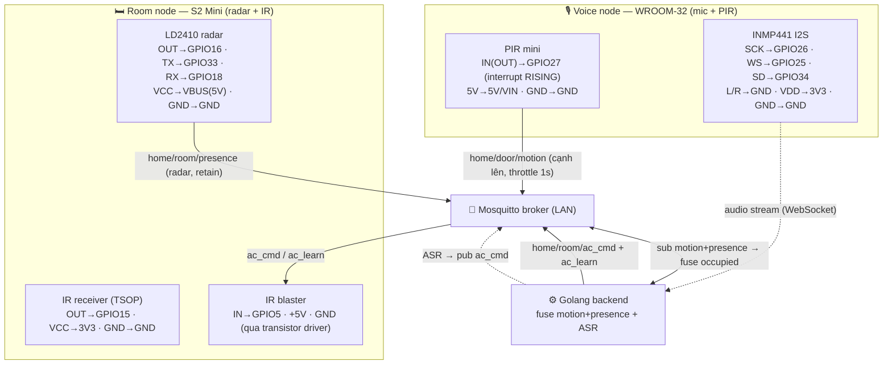

# Sơ đồ đấu nối IO — Hệ thống presence + AC + voice

Tài liệu đấu nối phần cứng cho toàn hệ thống. Xem sơ đồ bằng `/ck:preview` hoặc bất kỳ trình xem Markdown hỗ trợ Mermaid.

Cập nhật: 2026-07-16 (rev2). **PIR dời từ room-node (S2) sang voice-node (WROOM-32 GPIO27)**; room-node chỉ còn radar + IR; **fusion PIR+radar dời về backend**. Door-node cũ nghỉ hưu. Xem `plans/260716-1433-relocate-pir-to-voice-node-backend-fusion/`.

> **Nghiệm thu HW 2026-07-16:** room-node đã flash & chạy thật — radar → presence đúng (radar=1 khi có người, =0 khi trống, `present` VÀO/RA chuẩn, pub MQTT + NTP OK). **Phát hiện:** (1) mối hàn **radar OUT→GPIO16 chập chờn** (đọc HIGH giả khi hở; LED module tắt nhưng GPIO16 vẫn =1) → hàn lại chắc + gỡ khỏi cổng USB-C. (2) PIR cắm ngược 5V/GND trên S2 gây **nóng bỏng** (nghi hỏng) → đã dời sang voice-node. Debug bằng log `[hb]` mỗi 2s (xem `pio device monitor`).

## Tổng quan 2 node (MVP 1 phòng)

| Node | Board | Peripheral | Vai trò | Trạng thái |
|------|-------|-----------|---------|------------|
| **Room** | Wemos S2 Mini (ESP32-S2) | LD2410 radar + IR receiver + IR blaster | Radar → `home/room/presence`; nghe `ac_cmd`/`ac_learn` → điều khiển điều hòa | Firmware radar-only build pass; radar nghiệm thu HW; IR chưa có phần cứng |
| **Voice** | ESP32-WROOM-32 (38 chân) | INMP441 I2S mic + **PIR mini** | Stream audio → backend ASR → `ac_cmd`; **PIR → `home/door/motion`** | Firmware (audio+MQTT+PIR) build pass; chờ hàn mic + verify PIR |

Fusion `motion`(voice PIR) + `presence`(room radar) → occupied nằm ở **backend** (state machine). Door-node cũ (`firmware/door-node/`) giữ làm tham chiếu ISR, không flash.

## Sơ đồ hệ thống

## Pin map chi tiết

### Room node — Wemos S2 Mini (radar + IR)

| Peripheral | Chân module | S2 Mini | Ghi chú |
|-----------|-------------|---------|---------|
| LD2410 radar | OUT (presence) | **GPIO16** | MVP đọc chân digital này. ⚠️ Mối hàn từng chập chờn (đọc HIGH giả khi hở) — hàn lại chắc; đối chiếu LED trên module (LED↔GPIO16 phải nhất quán) |
| LD2410 radar | TX | **GPIO33** | UART để dành parse frame (MVP chưa dùng) |
| LD2410 radar | RX | **GPIO18** | UART để dành gửi config (MVP chưa dùng) |
| LD2410 radar | VCC / GND | **VBUS (5V)** / GND | |
| IR receiver (TSOP) | OUT | **GPIO15** | Chỉ dùng lúc học mã IR |
| IR receiver | VCC / GND | 3V3 / GND | |
| IR blaster | IN (tín hiệu) | **GPIO5** | Qua transistor driver: GPIO5→R220→Base (S8050/2N2222), Emitter→GND, Collector→IR LED cathode, LED anode→R68→5V |
| IR blaster | +5V / GND | 5V / GND | |

> **Trạng thái lắp thực tế room-node (2026-07-16):**
> - ✅ **LD2410 radar** — đã hàn (mối OUT→GPIO16 chập chờn, cần hàn lại). Ngoại vi DUY NHẤT đang gắn.
> - ⏳ **IR receiver (GPIO15) + IR blaster (GPIO5)** — CHƯA có phần cứng. Chân firmware dành sẵn; chưa đấu mạch. Vì chưa có IR nên luồng `ac_cmd`→IR (và voice→ac_cmd→IR) **chưa chạy thật được**.
> - Radar hàn đè cổng USB-C từng gây chập — không hàn đè USB-C; gỡ ra khi rảnh.

### Voice node — ESP32-WROOM-32 (mic + PIR)

| Peripheral | Chân module | WROOM-32 | Ghi chú |
|-----------|-------------|----------|---------|
| INMP441 | SCK (BCLK) | **GPIO26** | I2S bit clock (output ESP) |
| INMP441 | WS (LRCL) | **GPIO25** | I2S word select (output ESP) |
| INMP441 | SD (DOUT) | **GPIO34** | Data từ mic (34 input-only, hợp lý) |
| INMP441 | L/R | **GND** | Chọn kênh trái |
| INMP441 | VDD / GND | 3V3 / GND | |
| **PIR mini** | **IN (OUT tín hiệu)** | **GPIO27** | Có người → HIGH, interrupt RISING. Firmware `INPUT_PULLDOWN`. Silk ghi "IN" nhưng với PIR đây là ngõ RA |
| **PIR mini** | **5V** | **5V / VIN** | Cấp 5V, KHÔNG phải 3V3 |
| **PIR mini** | **GND** | GND | |

> ⚠️ **ĐO PIR + ĐẤU ĐÚNG CHỮ IN** (con PIR từng cắm ngược 5V/GND trên S2 → nóng bỏng, có thể đã hỏng):
> - Đấu theo **chữ in** (IN/5V/GND), KHÔNG theo vị trí — thứ tự chân khác nhau tùy hãng.
> - Đo áp chân OUT lúc HIGH: **~3.3V** cắm thẳng GPIO27; **~5V** phải chia áp (10k/20k) hoặc level shifter (GPIO WROOM max 3.3V).
> - Cấp điện xong sờ thử 5-10s: nóng nhanh → rút liền, PIR đã hỏng → thay con mới.
> - GPIO27 không phải strapping (0/2/5/12/15), hỗ trợ pulldown + interrupt — an toàn.

> WROOM-32 (không PSRAM) không chạy nhận-lệnh offline đầy đủ (ESP-SR MultiNet chỉ S3) → voice = stream audio lên backend ASR.
>
> **Firmware** (`firmware/voice-node/`): I2S RX 16kHz slot 32-bit mono trái (lấy 16-bit cao → PCM16). VAD năng lượng RMS > `VAD_THRESHOLD` mới stream; im `SILENCE_MS` (~800ms) thì ngừng gửi (giữ WS mở). Gửi PCM 16-bit 16kHz mono LE qua WS tới `ws://<backend>:8080/api/voice/stream`. Thêm MQTT client publish `home/door/motion` khi PIR kích. Build `pio run -e esp32dev` pass; chưa hàn mic → VAD threshold cần tune.

## Contract MQTT

| Topic | Publisher | Subscriber | Retain |
|-------|-----------|-----------|--------|
| `home/door/motion` | **Voice node (PIR GPIO27)** | Backend | false |
| `home/room/presence` | Room node (radar) | Backend | true |
| `home/room/ac_cmd` | Backend (voice ASR / state machine) | Room node | false |
| `home/room/ac_learn` | Backend (test tay) | Room node | false |

Backend fuse `motion`+`presence` → occupied. Audio voice KHÔNG qua MQTT — voice node nối WebSocket trực tiếp tới backend.

## Thứ tự triển khai

1. **Room node radar → presence** — firmware radar-only, verify qua broker (radar nghiệm thu HW).
2. **Voice node** — hàn INMP441 + PIR (GPIO27), flash; publish motion + stream audio.
3. **Backend** — fuse motion+presence, ASR. Xem `plans/260714-1025-golang-backend-presence-ac/`.
4. **IR** (khi có phần cứng) — TSOP + IR LED + transistor để học/phát mã điều hòa.
