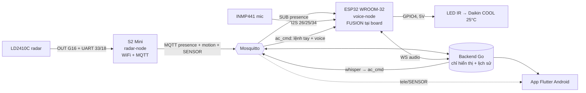

# Sơ đồ đấu nối IO — Hệ thống presence + AC + voice

Cập nhật: **2026-07-24 (rev4)** — kiến trúc **2 node WiFi độc lập, KHÔNG ESP-NOW, KHÔNG PIR**:
S2 Mini (`radar-node`) tự nối WiFi+MQTT đọc LD2410C **native UART**; WROOM (`voice-node`) có **mic + IR**,
**fusion tại board** (nghe `home/room/presence` → bắn IR Daikin). PIR đã bỏ khỏi hệ.

---

# ⚡ BẢNG HÀN — đọc cái này là đủ

## Board 1 — ESP32 WROOM-32 (38 chân) = voice-node (mic + IR)

| Thiết bị | Chân thiết bị | → Chân WROOM | Ghi chú |
|---|---|---|---|
| **INMP441 mic** | SCK (BCLK) | **GPIO26** | |
| | WS (LRCL) | **GPIO25** | |
| | SD (DOUT) | **GPIO34** | chân chỉ-vào, đúng cho mic |
| | L/R | **GND** | chọn kênh |
| | VDD | **3V3** | **KHÔNG 5V** |
| | GND | GND | |
| **IR Transmitter** | `DAT` | **GPIO4** | GPIO5 là strapping — không dùng |
| | `VCC` | **5V** | ✅ module nhãn 5V (tầm 1-2m). 3V3 bị under-drive → tầm ngắn |
| | `GND` | **GND** | |

> **PIR: BỎ.** GPIO27 để trống, firmware không gắn interrupt nữa.

> **⚠️ Chiều lắp mic (dễ sai, sai là hỏng hết):** module INMP441 dùng ở đây là **bo TRÒN Ø10**
> (con chip MEMS chữ nhật nằm trên bo). Nó là loại **CỬA ĐÁY** — lỗ thu âm ở **mặt in chữ**
> (`L/R WS SCK SD VDD GND`), không phải mặt có chip.
> Lắp vào nắp: **mặt in chữ NGỬA LÊN** áp vào trần hốc, **chip chúc xuống** khoang.
> Lắp ngược thì lỗ thu âm úp vào trong hộp → mic nghe tiếng khoang thay vì tiếng phòng, và
> **bịt gioăng càng kín càng tệ**.
> Dây hàn thẳng vào pad nằm **cùng mặt in chữ** ⇒ cục hàn kênh bo lên. Bù bằng **lớp đệm mềm
> (xốp 2 mặt)**, đừng bù bằng nhựa in — xốp mới ép quanh được cục hàn. Dây đi ra qua rãnh
> hông của bệ mic, không bẻ ngoặt quanh mép bo.

## Board 2 — Wemos S2 Mini = radar-node (LD2410C native UART)

| Thiết bị | Chân | → Chân S2 Mini | Ghi chú |
|---|---|---|---|
| **LD2410C radar** | OUT | **GPIO16** | presence digital |
| | TX | **GPIO33** | S2 nhận — UART @256000 (Moving/Static) |
| | RX | **GPIO18** | S2 gửi |
| | VCC | **5V** (VBUS) | radar cần 5V |
| | GND | **GND** | ⚠️ **PHẢI chung GND với S2** — mất GND chung thì UART chết (Moving=0) dù BLE vẫn mượt |

**S2 tự nối WiFi + MQTT** (không ESP-NOW, không IR, không PIR).

## Nguồn chung (Topo A — S2 là board nguồn)

```
Cốc sạc ≥2A ─C-to-C─► USB-C của S2
   S2 5V/VBUS ──► WROOM chân 5V/VIN   (đi TẮT qua diode → WROOM ăn 5.0V thay vì 4.7V)
   S2 GND     ──► WROOM GND
```
Chỉ chung **5V + GND**, KHÔNG chung 3V3. **Không cắm USB WROOM khi dây liên board còn nối** (2 nguồn đánh
nhau) → dùng OTA để nạp. Board WROOM cũ biên nguồn mỏng → cần tụ 470-1000µF ở 5V-GND (board mới không cần).

---

## Biến thể — S2 Mini native WiFi + MQTT (`firmware/radar-node`)

Thay cho lối ESP-NOW (và cho firmware cũ trên con S2): con S2 **tự nối WiFi + MQTT**, đọc
LD2410C native qua UART rồi bắn thẳng lên broker. Cùng module radar, thêm **2 chân UART**:

| Thiết bị | Chân | → Chân S2 Mini | Ghi chú |
|---|---|---|---|
| **LD2410C** | OUT | **GPIO16** | presence digital (INPUT_PULLDOWN) |
| | TX | **GPIO33** | radar TX → S2 nhận |
| | RX | **GPIO18** | S2 gửi lệnh cấu hình → radar RX |
| | VCC | **5V** (VBUS) | radar cần 5V |
| | GND | **GND** | |

Publish: `home/room/presence {"ts","present"}` (backend Go ăn → đẩy app) **và**
`tele/<DEVICE_TOPIC>/SENSOR` + trả lời `cmnd/<T>/STATUS 10` (tab "Thiết bị" app đọc thẳng).
Nạp: `pio run -t upload -e lolin_s2_mini`. ⚠️ **Không hàn radar đè lên cổng USB-C** (đã chập).

---

# 🔥 Cảnh báo (đều đã trả giá thật)

### 1. LD2410 PHẢI chung GND với board đọc nó
23/07: tách nguồn S2 sang cốc riêng mà quên kéo GND chung → **Moving/Static = 0** dù `Detect=1` và **app
BLE của HLK vẫn xem mượt có energy**. UART cần GND làm return path; BLE không cần nên vẫn chạy → đó là dấu
hiệu vàng phân biệt "module hỏng" với "mất GND". Luôn nuôi cảm biến **từ chính board đọc nó**.

### 2. IR Transmitter — module này cấp **5V** (đã kiểm chứng)
Module `IR Transmitter V1221` nhãn ghi **5V, tầm 1-2m, 940nm** → cấp 5V là **đúng thiết kế**, và thực tế
**bắn xa hơn thật**. Cấp 3V3 bị under-drive → tầm ngắn.
> Rev cũ ghi "cấp 3V3, KHÔNG 5V" — **đã sửa**: cảnh báo đó chỉ đúng với module LED-trần không có tầng đệm.
> Nguyên tắc chung vẫn giữ: **đừng bao giờ đưa 5V vào chân `DAT`** (GPIO chỉ chịu 3.3V) — chỉ VCC ăn 5V.

### 3. LED IR **vô hình với mắt** — đừng tưởng nó không chạy
940nm mắt người không thấy. Kiểm bằng cách **chĩa camera điện thoại vào đầu LED** → thấy nháy tím/trắng.
Đã mất nhiều lượt debug vì tưởng "LED không sáng = mạch chết", trong khi firmware vẫn bắn đúng.

### 4. IR phát dùng GPIO4, KHÔNG dùng GPIO5
Trên WROOM-32, **GPIO5 là chân strapping** (phải HIGH lúc boot) — đèn IR kéo xuống LOW là
**board không boot**. Strapping của ESP32 theo tài liệu ESP-IDF: **GPIO0, 2, 5, 12, 15**.
GPIO4 **không** nằm trong đó → an toàn.

> Red-team từng báo "GPIO4 cũng là strapping, phải dùng GPIO17" — **SAI**, đã kiểm chứng
> bằng tài liệu chính thức Espressif. Giữ GPIO4.

---

# 📍 Đặt ở đâu

| Board | Vị trí | Vì sao |
|---|---|---|
| **WROOM** (mic + IR) | **Chĩa vào mắt nhận của dàn lạnh** | Module IR chạy 5V bắn **1-2m**; nếu dàn lạnh trên cao thì nghiêng mặt phát lên ~20-40°. Vẫn nên gần + chĩa thẳng. |
| **S2 Mini** (radar) | **Trên cao, nhìn bao quát phòng** | LD2410 tầm ~6m |

**Mic nằm cùng WROOM tức là cùng chỗ với điều hoà.** Nếu bạn nằm xa mà nói không nghe rõ,
đó là đánh đổi của việc gom IR+mic một board. Muốn tách: **kéo dài dây LED IR được**
(IR không kén dây dài), **đừng kéo dài dây mic** (I2S tốc độ cao, kén dây).

---

# 🔌 Nguồn — Topo A (S2 là board nguồn)

```
Cốc sạc ≥2A ─C-to-C─► USB-C của S2 (board nguồn duy nhất)
   S2 5V/VBUS ──► WROOM chân 5V/VIN
   S2 GND     ──► WROOM GND
```

**Vì sao S2 làm nguồn, không phải WROOM:** WROOM có **diode nối tiếp USB→5V** rớt ~0.3V nên chân 5V chỉ
**4.7V**, sát dropout AMS1117 → gốc brownout. **Bơm vào chân VIN là đi TẮT qua diode** → WROOM ăn 5.0V.
S2 không có diode (chân 5V = 5.0V) nên nó mới là nguồn tốt. (Kế hoạch cũ 16/07 chọn WROOM làm board nguồn —
**SAI hướng**, dồn thêm tải qua đúng cái diode đang sụt áp.)

- **Chỉ chung 5V + GND, KHÔNG chung 3V3** (mỗi board có LDO riêng).
- **Không cắm USB của board được nuôi cùng lúc** — 2 nguồn 5V đánh nhau → dùng **OTA** để nạp.
- Nên **hàn** 2 dây liên board (dupont lỏng → gai dòng WiFi làm sụt áp → brownout tái phát).
- Board WROOM **cũ** brownout tại `WiFi.mode()` → cần **tụ 470-1000µF ở 5V-GND**. Board **mới** không cần
  (đã kiểm chứng bằng swap: cùng firmware, 0 brownout) → **firmware không phải nguyên nhân**.

---

# Luồng dữ liệu



**ESP32 là nơi DUY NHẤT quyết định bật/tắt điều hoà tự động.** Backend chỉ hiển thị
(app + lịch sử + chart) và chuyển tiếp lệnh tay. Để cả hai cùng quyết thì chúng lệch nhau
theo thời gian và không ai biết tin bên nào.

**Điều hoà Daikin** → dùng giao thức có sẵn trong `IRremoteESP8266`, **không cần TSOP,
không cần học mã**. Mặc định khi tự bật: **25°C, COOL, quạt AUTO** (Daikin gửi trọn 35 byte
trạng thái mỗi lần, không có "lệnh bật" riêng).

---

# Nạp firmware

**ESP-NOW đã BỎ** — cả 2 board tự nối WiFi + MQTT nên **không còn ràng buộc cùng kênh**, không cần điền
MAC peer, không có thứ tự nạp bắt buộc. Nạp board nào trước cũng được.

| Board | Cách nạp |
|---|---|
| **WROOM** (voice-node) | USB: `pio run -e esp32dev -t upload` · **OTA**: `pio run -e esp32dev_ota -t upload` |
| **S2 Mini** (radar-node) | USB: giữ BOOT + tap RST, `pio run -e lolin_s2_mini -t upload` · **OTA**: `pio run -e lolin_s2_mini_ota -t upload` |

OTA cần `export OTA_PASSWORD='...'` (khớp `OTA_PASSWORD` trong `include/config.h`). Giữ env USB làm **đường
lui** — bản nào làm chết WiFi thì OTA bó tay.

> WSL: `usbipd attach --wsl --auto-attach --busid <id>`. S2 native-USB **đổi cổng khi reset**
> (`ttyACM0`→`ttyACM1`) nên cần `--auto-attach`; lần upload đầu hay fail, chạy lại là được.

# Kiểm tra sau khi hàn

| Việc | Cách |
|---|---|
| **IR có bắn không** | **Chĩa camera điện thoại vào LED IR** → thấy nháy tím/trắng (mắt người KHÔNG thấy IR) |
| **AC vào COOL chưa** | Nghe dàn lạnh **"bíp"** + xem icon ❄ trên dàn lạnh (không phải quạt/giọt nước) |
| Radar sống không | Sub broker: `tele/<T>/SENSOR` phải có `Detect:1` và **Moving/Static đổi liên tục** khi quơ tay |
| **Moving=0 mà Detect=1** | → **mất GND chung** (không phải module hỏng). Kiểm chứng: app BLE của HLK vẫn mượt = module khỏe |
| Presence tới voice-node chưa | Serial WROOM: `[hb] presence=1 link=up occupied=1 seq=N` — `seq` phải tăng |
| **Rút S2 có tự xử không** | **Rút điện S2** → broker bắn will `present:false` (~15-20s) → Home hết "Có người"; WROOM sau 90s coi vắng → AC tắt |
| Mic có nghe không | Serial WROOM: nói to → `RMS` vọt lên >2500 + `VAD: phát hiện tiếng nói` |
| Voice E2E | Nói "bật điều hòa" → serial phải in `[ir] Daikin ON (25C)` |

# Liên quan
- [`system-architecture.md`](./system-architecture.md)
- [`project-roadmap.md`](./project-roadmap.md)
- Vỏ hộp: `hardware/vo-hop-modular.scad` (3 mảnh in rời, PETG 3mm)
