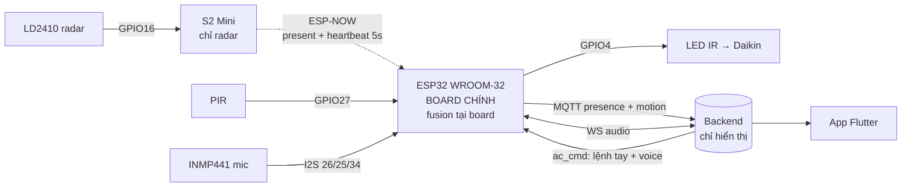

# Sơ đồ đấu nối IO — Hệ thống presence + AC + voice

Cập nhật: **2026-07-17 (rev3)** — kiến trúc **ESP32 WROOM-32 làm board chính**:
S2 Mini chỉ đọc radar rồi gửi qua **ESP-NOW**; **PIR + IR + mic đều ở WROOM**;
**fusion tại board** (không còn ở backend). Xem `plans/260717-1105-espnow-esp32-main-board/`.

---

# ⚡ BẢNG HÀN — đọc cái này là đủ

## Board 1 — ESP32 WROOM-32 (38 chân) = BOARD CHÍNH

| Thiết bị | Chân thiết bị | → Chân WROOM | Ghi chú |
|---|---|---|---|
| **INMP441 mic** | SCK (BCLK) | **GPIO26** | |
| | WS (LRCL) | **GPIO25** | |
| | SD (DOUT) | **GPIO34** | chân chỉ-vào, đúng cho mic |
| | L/R | **GND** | chọn kênh |
| | VDD | **3V3** | **KHÔNG 5V** |
| | GND | GND | |
| **PIR** (con mới) | `IN` | **GPIO27** | |
| | `5V` | **5V** (VIN) | |
| | `GND` | **GND** | |
| **IR Transmitter** | `DAT` | **GPIO4** | |
| | `VCC` | **3V3** | **KHÔNG 5V** — xem cảnh báo |
| | `GND` | **GND** | |

## Board 2 — Wemos S2 Mini = CHỈ RADAR

| Thiết bị | Chân | → Chân S2 Mini | Ghi chú |
|---|---|---|---|
| **LD2410 radar** | OUT | **GPIO16** | **mối này đang chập chờn — hàn lại cho chắc** |
| | VCC | **5V** (VBUS) | radar cần 5V |
| | GND | **GND** | |

**Không nối gì khác vào S2 Mini.** Nó không còn IR, không còn PIR, không còn WiFi.

---

# 🔥 Ba cảnh báo (đều đã trả giá thật)

### 1. PIR — đấu ĐÚNG CHỮ IN, con cũ đã chết vì cắm ngược
Con PIR trước **nóng bỏng tay 2 lần rồi hỏng** vì đảo `5V`/`GND`.
**Đọc chữ in trên board PIR (`IN`/`5V`/`GND`), đừng theo trí nhớ hay màu dây.**
Đo đồng hồ trước khi cấp nguồn. **Ấm bất thường → rút ngay.**

### 2. IR Transmitter — cấp 3V3, KHÔNG cấp 5V
GPIO của ESP32 **không chịu được 5V**. Nếu module có điện trở kéo lên VCC ở chân `DAT`
thì cấp 5V = đẩy 5V thẳng vào GPIO4 → **chết chân, có thể chết board**.
3V3 qua điện trở 220Ω trên module ≈ 9mA — an toàn cho GPIO, LED vẫn đủ sáng.

### 3. IR phát dùng GPIO4, KHÔNG dùng GPIO5
Trên WROOM-32, **GPIO5 là chân strapping** (phải HIGH lúc boot) — đèn IR kéo xuống LOW là
**board không boot**. Strapping của ESP32 theo tài liệu ESP-IDF: **GPIO0, 2, 5, 12, 15**.
GPIO4 **không** nằm trong đó → an toàn.

> Red-team từng báo "GPIO4 cũng là strapping, phải dùng GPIO17" — **SAI**, đã kiểm chứng
> bằng tài liệu chính thức Espressif. Giữ GPIO4.

---

# 📍 Đặt ở đâu

| Board | Vị trí | Vì sao |
|---|---|---|
| **WROOM** (mic + PIR + IR) | **Sát mắt nhận của dàn lạnh** | LED IR chỉ bắn xa **10-50cm** — 1 LED lấy dòng thẳng từ GPIO. Phải dán gần, chĩa thẳng vào mắt nhận. |
| **S2 Mini** (radar) | **Trên cao, nhìn bao quát phòng** | LD2410 tầm ~6m |

**Mic nằm cùng WROOM tức là cùng chỗ với điều hoà.** Nếu bạn nằm xa mà nói không nghe rõ,
đó là đánh đổi của việc gom IR+mic một board. Muốn tách: **kéo dài dây LED IR được**
(IR không kén dây dài), **đừng kéo dài dây mic** (I2S tốc độ cao, kén dây).

---

# 🔌 Nguồn

Hai board **hai nguồn riêng** — ESP-NOW không giải quyết bài toán nguồn chung.
Muốn 1 cốc sạc: WROOM `5V`(VIN) → S2 `VBUS`, WROOM `GND` → S2 `GND`.
**Chỉ chung 5V + GND, KHÔNG chung 3V3** (mỗi board có LDO riêng).
**Không cắm USB của board được nuôi cùng lúc** — 2 nguồn 5V đánh nhau.

---

# Luồng dữ liệu

**ESP32 là nơi DUY NHẤT quyết định bật/tắt điều hoà tự động.** Backend chỉ hiển thị
(app + lịch sử + chart) và chuyển tiếp lệnh tay. Để cả hai cùng quyết thì chúng lệch nhau
theo thời gian và không ai biết tin bên nào.

**Điều hoà Daikin** → dùng giao thức có sẵn trong `IRremoteESP8266`, **không cần TSOP,
không cần học mã**. Mặc định khi tự bật: **25°C, COOL, quạt AUTO** (Daikin gửi trọn 35 byte
trạng thái mỗi lần, không có "lệnh bật" riêng).

---

# Ràng buộc ESP-NOW

**S2 phải cùng kênh WiFi với WROOM.** WROOM nối WiFi (audio + MQTT + OTA) nên radio của nó
bị khoá vào kênh của router; ESP-NOW không đổi được kênh đó. S2 **quét SSID để dò kênh**.
Sai kênh → gói bay vào hư không, **không có báo lỗi**. Router đổi kênh → S2 tự quét lại
sau 3 lần gửi FAIL.

# Nạp firmware

| Board | Cách nạp |
|---|---|
| **WROOM** | USB (tự reset) **hoặc OTA WiFi**: `pio run -e esp32dev_ota -t upload` |
| **S2 Mini** | **CHỈ USB** — giữ BOOT + tap RST. Bỏ WiFi nên **mất OTA vĩnh viễn** (đánh đổi đã chấp nhận khi chọn ESP-NOW) |

**Thứ tự bắt buộc:**
1. Nạp **WROOM trước** → đọc serial: `[espnow] MAC board này: XX:XX:XX:XX:XX:XX`
2. Điền MAC đó vào `firmware/room-node/include/config.h` → `ESPNOW_PEER_MAC`
3. Nạp **S2 sau**
4. Backend (tắt auto `ac_cmd`) **làm cuối cùng**

Sai thứ tự → có khoảng thời gian **không ai điều khiển điều hoà**.
Đường lui: `git revert` firmware về `9d65f82`.

# Kiểm tra sau khi hàn

| Việc | Cách |
|---|---|
| **IR có bắn không** | **Chĩa camera điện thoại vào LED IR** → thấy nháy tím/trắng (mắt người không thấy IR) |
| ESP-NOW thông chưa | Serial WROOM: `[hb] radar=1 link=up seq=42` — `seq` phải tăng đều |
| **Link chết có tự xử không** | **Rút điện S2** → sau 15s WROOM phải in `link=DOWN present=0`. Không có cái này thì S2 chết là điều hoà chạy vĩnh viễn. |
| PIR sống không | Khoát tay → serial in motion |
| Radar sống không | Serial S2: `[radar] present -> 1` |
| Kênh có khớp không | So `[espnow] đang ở kênh N` (WROOM) với `[espnow] thấy SSID ... ở kênh N` (S2) |

# Liên quan
- [`system-architecture.md`](./system-architecture.md)
- [`project-roadmap.md`](./project-roadmap.md)
- `plans/260717-1105-espnow-esp32-main-board/`
