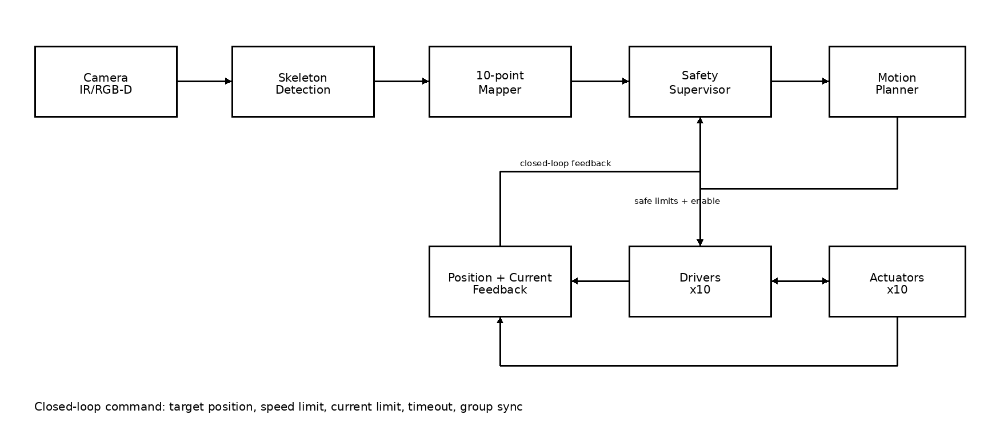
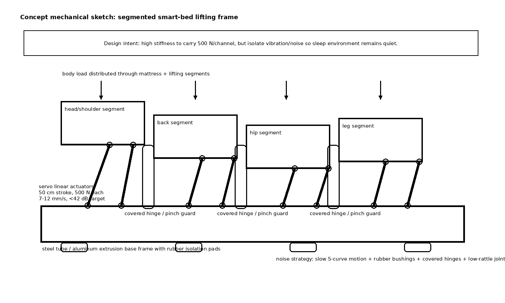

## Scope and source basis

This design covers the SmartBed subsystem that detects the user's sleep posture from a camera/skeleton pipeline and adjusts **10 servo linear actuators**. The supplied MVP PDF describes a soundproof smart-bed/pod with hidden non-contact sensors, camera-based sleep-position tracking, 10 servo lifter engines, 50 cm lift, 500 N push force, 7-12 mm/s movement speed, and noise target below 42 dB. It also lists modular vital-sign sensors, loadcell/presence/breath sensing, and emergency safety components such as smoke sensor, mini fire stop, and auto-opening smart lock. The PDF is an MVP concept/spec, so missing actuator datasheet details are stated as assumptions rather than invented.

## 1. System block diagram and closed-loop control

{ width=100% }

The camera module estimates body landmarks, body size, sleep position, and movement. The **10-point mapper** converts skeleton landmarks into target heights for five paired bed zones: head/shoulder, back, hip, thigh, and lower-leg. These targets are not sent directly to the motor drivers. They first pass through the **Safety Supervisor**, which verifies command limits, position feedback, motor current, timeout, left-right mismatch, and camera confidence. The **Motion Planner** then generates smooth speed-limited trajectories. The actuator drivers report position/current/fault information back into the Safety Supervisor; this makes the bed a closed-loop safety system rather than a one-way AI-to-motor system.

## 2. Mechanical concept, material choice, and noise trade-offs

{ width=100% }

The actuator mechanism uses paired servo linear actuators under segmented lifting panels. Each actuator is mounted through clevis/rod-end joints so it mainly receives axial load, reducing side-load and binding risk. The lifting panels sit above a stiff base frame; the actuator force is distributed through segments instead of pushing directly into a soft mattress.

| Design choice | Rationale | Trade-off |
|---|---|---|
| Lead-screw/self-locking servo linear actuator | Suitable for slow 7-12 mm/s motion and can hold position during power loss | Slower than pneumatic systems; must check duty cycle and stall current from real datasheet |
| Steel tube base frame for MVP | High stiffness and low cost for 500 N/channel loads | Heavier and can transmit vibration if not isolated |
| Aluminum extrusion for later revision | Lighter, modular, easier to assemble | Higher cost and may need reinforcement at actuator mounts |
| Rubber bushings, covered hinges, anti-rattle joints | Helps keep noise below 42 dB and avoids harsh impacts | Adds compliance, so position control must tolerate small mechanical flex |
| Segmented panels with guarded hinge gaps | Allows posture shaping while reducing pinch hazard | More parts, more alignment effort |

## 3. Safety and fail-safe design

Safety is the main design driver because a person is lying on the mechanism. The baseline rule is: **AI proposes posture, Safety Supervisor permits motion**. If sensor confidence is low or feedback is inconsistent, the default behavior is to stop or only allow slow lowering.

| Risk case | Mechanical fail-safe | Electrical fail-safe | Firmware fail-safe |
|---|---|---|---|
| Actuator jam / overload | Clevis joints reduce side-load; mechanical end stops prevent overtravel | Current sensing per channel, driver current limit, fuse/polyfuse per actuator | If command is active but position does not change, or current rises above limit, stop the affected pair/group and enter safe mode |
| Position mismatch / frame twist | Paired left-right actuators per body zone and stiff cross members | Fault line from each driver to controller | Compare target vs actual position and left-right delta; if mismatch exceeds threshold, stop both paired actuators and re-level if safe |
| Hand/leg in pinch zone | Covered hinges, rounded guards, minimum gap/soft edge around moving joints | Emergency stop can remove actuator power | Camera/skeleton defines virtual pinch zones. If body part is inside danger zone or camera confidence is low, block automatic movement |
| Power loss while raised | Prefer self-locking lead-screw actuator; mechanical brake if actuator is not self-locking | Small backup energy module for controller/state save or controlled slow lowering | On reboot, do not resume previous command. Read actual positions, verify occupancy, then home or lower slowly before accepting new posture commands |

**Safety Reflex Layer (enhancement).** Beyond stop-on-fault behavior, the system can monitor early risk trends: current slope, growing position error, increasing left-right mismatch, low skeleton confidence, and possible pinch-zone intrusion. The default reflex is pause or reduce speed. Only if the movement direction is verified safe, the bed may retract the affected actuator group by a few millimeters or lower slowly. This is feasible with normal driver feedback and does not require full medical-grade hardware for the MVP; camera-based pinch detection is treated as a supporting signal, not the only safety layer.

## 4. Synchronizing 10 actuators smoothly

The 10 actuators are controlled as five paired zones. The Motion Planner generates time-scaled S-curve or trapezoidal trajectories so all actuators in a group finish together even if their travel distances differ. Commands include target position, speed limit, current limit, timeout, and group ID. The planner caps speed to the MVP range of 7-12 mm/s, limits acceleration to avoid jerks, and continuously checks feedback. If one actuator lags or stalls, the group is stopped instead of allowing the other actuators to continue and twist the bed.

## 5. Assumptions and missing datasheet items

1. The actuator has position feedback through potentiometer, Hall sensor, encoder, or servo controller feedback. Without feedback, closed-loop synchronization is not acceptable for a bed with a person on it.
2. The actuator or external mechanism is self-locking during power loss. If not, a brake, counterbalance, or backup lowering circuit is mandatory.
3. Actual voltage, rated current, stall current, duty cycle, backlash, and mounting dimensions are not available in the MVP PDF and must be confirmed from the real actuator datasheet.
4. Camera/skeleton tracking can be blocked by blanket or darkness, so it is used with confidence gating and never as the only safety mechanism.
5. This MVP design is not a certified medical device. Before real deployment it requires load testing, pinch testing, electrical safety review, and long-duration noise/thermal tests.
