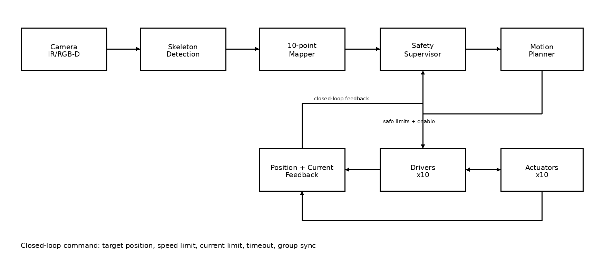
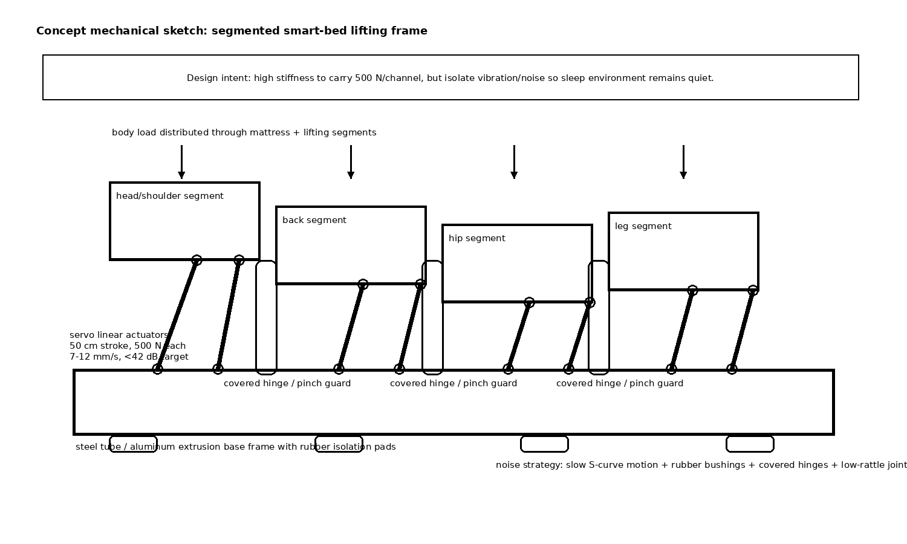

## Phạm vi và cơ sở từ tài liệu MVP

Tài liệu này thiết kế hệ con SmartBed dùng camera để nhận diện khung xương người nằm và điều khiển **10 servo linear actuator** nâng/hạ tư thế ngủ. File MVP mô tả SmartBed là một sleeping pod có cảm biến không tiếp xúc, camera theo dõi tư thế ngủ, 10 servo lifter engines, hành trình 50 cm, lực đẩy 500 N, tốc độ 7-12 mm/s và độ ồn mục tiêu dưới 42 dB. File cũng nêu ý tưởng cảm biến modular như loadcell, presence/breath sensing, SpO2, microphone, cùng cơ chế emergency ở mức hệ thống như smoke sensor, mini fire stop và smart lock tự mở khi khẩn cấp. Vì PDF này là tài liệu MVP, không phải datasheet actuator đầy đủ, các thông số còn thiếu được ghi ở phần giả định thay vì tự bịa.

## 1. Sơ đồ khối và vòng điều khiển kín

{ width=100% }

Luồng chính là: **Camera IR/RGB-D -> Skeleton Detection -> 10-point Mapper -> Safety Supervisor -> Motion Planner -> Drivers x10 -> Actuators x10**. Camera ước lượng landmark cơ thể, kích thước cơ thể, tư thế ngủ và mức cử động. Khối **10-point Mapper** ánh xạ skeleton sang 10 điểm nâng của giường, chia thành 5 vùng theo cặp trái/phải: đầu/vai, lưng, hông, đùi và cẳng chân.

Điểm quan trọng là lệnh từ AI không đi thẳng xuống motor. **Safety Supervisor** kiểm tra giới hạn hành trình, tốc độ, dòng motor, timeout, độ lệch trái/phải, vùng kẹp và độ tin cậy của camera. Sau đó **Motion Planner** mới tạo quỹ đạo nâng/hạ mượt. Driver và actuator trả về vị trí, dòng, limit switch và lỗi driver vào khối **Position + Current Feedback**, rồi quay lại Safety Supervisor. Vì vậy hệ thống là điều khiển vòng kín, không phải một chiều từ camera sang actuator.

## 2. Cơ khí, vật liệu và trade-off tiếng ồn

{ width=100% }

Cơ chế đề xuất dùng các actuator tuyến tính đặt dưới các tấm nâng dạng segment. Mỗi actuator gắn bằng clevis hoặc rod-end joint để lực truyền chủ yếu theo trục actuator, giảm side-load và giảm kẹt cơ khí. Actuator không đẩy trực tiếp vào nệm mềm mà đẩy vào tấm nâng/khung phụ để phân bố lực tốt hơn.

| Lựa chọn thiết kế | Lý do chọn | Trade-off |
|---|---|---|
| Servo linear actuator dạng vít me/self-locking | Phù hợp chuyển động chậm 7-12 mm/s, giữ vị trí tốt khi mất điện nếu có tự hãm | Chậm hơn khí nén; cần kiểm tra duty cycle và stall current từ datasheet thật |
| Khung nền thép hộp cho MVP | Cứng, rẻ, chịu tải tốt với mức 500 N mỗi kênh | Nặng hơn và dễ truyền rung nếu không cách ly |
| Nhôm định hình cho bản sau | Nhẹ, modular, dễ lắp ráp | Đắt hơn và cần gia cường tại vị trí gá actuator |
| Cao su giảm chấn, bushing, khớp chống rơ | Giảm rung/ồn để giữ mục tiêu <42 dB | Làm tăng độ đàn hồi, thuật toán vị trí phải chịu được flex nhỏ |
| Tấm nâng chia segment, che khe bản lề | Tạo tư thế ngủ linh hoạt và giảm nguy cơ kẹp | Nhiều chi tiết hơn, cần căn chỉnh chính xác hơn |

## 3. Cơ chế an toàn và fail-safe

Vì có người đang nằm trên giường, nguyên tắc an toàn là: **AI chỉ đề xuất tư thế, Safety Supervisor mới cho phép chuyển động**. Nếu sensor không tin cậy hoặc feedback mâu thuẫn, hành vi mặc định là dừng hoặc chỉ cho hạ chậm.

| Rủi ro | Fail-safe cơ khí | Fail-safe điện | Fail-safe firmware |
|---|---|---|---|
| Actuator kẹt/quá tải | Khớp clevis giảm side-load; chặn hành trình cơ khí chống overtravel | Đo dòng từng kênh, driver current limit, fuse/polyfuse từng actuator | Nếu có lệnh chạy nhưng vị trí không đổi, hoặc dòng vượt ngưỡng, dừng cả cặp/nhóm actuator và vào safe mode |
| Lệch vị trí/xoắn khung | Actuator trái/phải theo từng vùng, khung ngang đủ cứng | Driver có fault line về controller | So sánh target với actual position và left-right delta; nếu lệch quá ngưỡng, dừng cả cặp và re-level nếu an toàn |
| Tay/chân vào vùng kẹp | Che bản lề, bo góc, mép mềm, giới hạn khe nguy hiểm | Emergency stop cắt nguồn actuator | Camera/skeleton tạo virtual pinch zones. Nếu tay/chân nằm trong vùng nguy hiểm hoặc camera confidence thấp, khóa chuyển động tự động |
| Mất điện khi đang nâng | Ưu tiên actuator vít me tự hãm; nếu không có thì cần phanh/counterbalance | Backup energy nhỏ để lưu trạng thái hoặc hạ chậm | Khi có điện lại không chạy tiếp lệnh cũ. Đọc vị trí thật, kiểm tra người còn nằm, homing/hạ chậm trước khi nhận lệnh mới |

**Safety Reflex Layer - ý tưởng nâng cao.** Ngoài việc dừng khi lỗi đã xảy ra, hệ thống theo dõi xu hướng nguy hiểm sớm như dòng motor tăng nhanh, position error tăng, độ lệch trái/phải tăng, camera confidence giảm hoặc có body part gần vùng kẹp. Phản xạ mặc định là pause hoặc giảm tốc. Chỉ khi hướng chuyển động đã được xác minh là an toàn, hệ thống mới lùi nhẹ nhóm actuator vài mm hoặc hạ chậm vùng liên quan. Lớp này khả thi vì dùng chính feedback vị trí/dòng từ driver; camera-based pinch detection chỉ là tín hiệu hỗ trợ, không phải lớp an toàn duy nhất.

## 4. Đồng bộ 10 actuator để chuyển động mượt

10 actuator được điều khiển thành 5 nhóm trái/phải theo vùng cơ thể. Motion Planner tạo quỹ đạo S-curve hoặc trapezoidal có time-scaling để các actuator trong cùng nhóm kết thúc cùng lúc dù quãng đường khác nhau. Lệnh gửi xuống driver gồm: target position, speed limit, current limit, timeout và group ID. Tốc độ bị giới hạn trong khoảng 7-12 mm/s theo MVP, gia tốc được giới hạn để tránh giật và giảm tiếng ồn. Nếu một actuator bị lag hoặc stall, cả nhóm dừng thay vì để các actuator còn lại tiếp tục chạy gây xoắn khung.

Ví dụ: nếu actuator trái vùng lưng cần đi 80 mm, actuator phải cần đi 40 mm, Motion Planner không cho cả hai chạy cùng tốc độ. Nó time-scale để cả hai hoàn thành cùng thời điểm, nhờ đó mặt giường không bị vặn.

## 5. Giả định và thông tin còn thiếu

1. Actuator có feedback vị trí bằng potentiometer, Hall sensor, encoder hoặc servo controller feedback. Nếu không có feedback, không nên dùng cho giường có người nằm.
2. Actuator hoặc cơ cấu ngoài có self-locking khi mất điện. Nếu không có, cần phanh cơ khí, counterbalance hoặc mạch backup lowering.
3. PDF MVP chưa có điện áp, dòng định mức, dòng stall, duty cycle, backlash, kích thước gá và loại feedback thật của actuator; cần xác minh bằng datasheet nhà sản xuất.
4. Camera/skeleton có thể bị che bởi chăn hoặc thiếu sáng, nên chỉ dùng cùng confidence gating và không bao giờ là lớp an toàn duy nhất.
5. Đây là thiết kế MVP chưa phải thiết bị y tế được chứng nhận. Trước khi chạy phần cứng thật cần test tải, test kẹp, test điện, test tiếng ồn và test nhiệt dài hạn.
